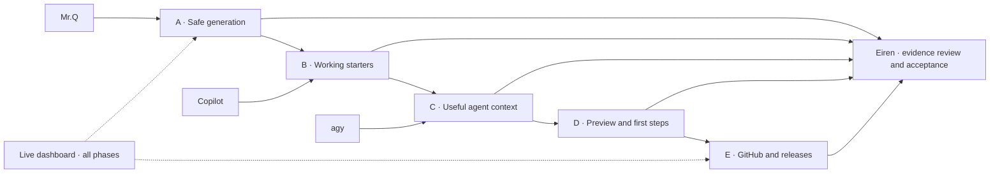

# Agent Bootstrap — execution roadmap

Coordinator: Eiren. Created: 2026-10-17T23:24:55-03:00.

Product workspace: `/Users/mac/ops/worktrees/project-bootstrapper-plan`. Original checkout and untracked files preserved.

Approved plan: [/Users/mac/ops/worktrees/project-bootstrapper-plan/docs/superpowers/plans/2026-10-17-bootstrap-product-improvement-plan.md](/Users/mac/ops/worktrees/project-bootstrapper-plan/docs/superpowers/plans/2026-10-17-bootstrap-product-improvement-plan.md)

All owners below are planned responsibilities. Only rows with a linked assignment are authorized worker tasks. Dependencies mean coordinator ACCEPTANCE, not merely a finished process. No automatic dispatch.

| Task | Owner | Deliverable | Waits for |
|---|---|---|---|
| A1 | Mr.Q | Colisiones de rutas y conflictos archivo/directorio | Ready |
| A2 | Mr.Q | Serialización segura de metadatos | B1 |
| A3 | Mr.Q | Identidad, opciones y preparación atómica | A1, A2 |
| B1 | Mr.Q | Chart Helm que pasa lint y render | Ready |
| B2 | Mr.Q | Starter TypeScript instalable y ejecutable | A2 |
| B3 | Mr.Q | Perfil Python de referencia y límites Rails | A3, B2 |
| C1 | agy | Formatos válidos de adaptadores de agentes | V1 |
| C2 | agy | Contexto común con comandos reales del perfil | B3, C1 |
| C3 | agy | Skills, memoria e integraciones coherentes | C2 |
| D1 | Mr.Q | Plan de generación y vista previa sin efectos | A3, C3 |
| D2 | agy | Comprobaciones y primeros pasos honestos | D1 |
| E1 | Mr.Q | Una historia Git y preparación remota recuperable | D2 |
| E2 | agy | CI, artefactos instalados y gates de publicación | E1 |
| E3 | Eiren | Revisión integrada y evidencia de la versión | E2 |
| V1 | agy | Dashboard local de seguimiento en agent-coordination | Ready |

Timing: started_at and finished_at describe the real CLI process; duration_seconds is measured elapsed runtime. Missing times mean not executed. Coordinator review time is separate. Logs and process exit alone are not evidence of accepted implementation.

Team update 2026-10-17T23:28:54-03:00: Copilot removed by user; historical attempts remain in run records. Active execution team: Mr.Q and agy, coordinated by Eiren.
