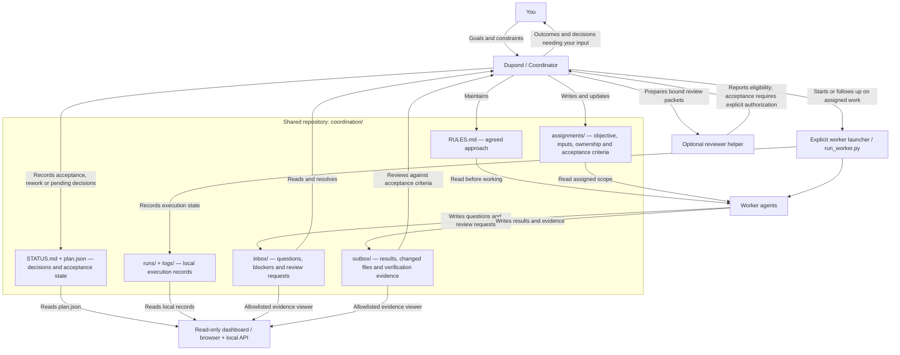

# Dupond coordination architecture

This workspace defines a file-based coordination contract. You give the goal to
Dupond, the coordinator, who assigns bounded work, reviews evidence, resolves
dependencies and records decisions. Workers share the same rules and communicate
through assignment and handoff files.

## How one assignment moves through the system

1. The coordinator writes an assignment with explicit inputs, owned files,
   required output and acceptance criteria.
2. The coordinator explicitly dispatches it through an available authorized tool.
   Creating a file alone does not start or wake an agent.
3. The worker reads the rules and assignment, performs the bounded work and
   preserves other workers' changes.
4. The worker writes questions or blockers to `inbox/` and results with verification
   evidence and remaining limitations to `outbox/`. Messages identify the author,
   assignment, recipient, kind, dependencies and requested decision or result.
5. The coordinator reviews the evidence against the assignment, records the
   disposition and message paths in `STATUS.md`, and updates or dispatches follow-up
   work as needed. A worker's completion report alone does not mean acceptance.

## Scope of this diagram

The worker launcher explicitly starts authorized local CLI workers and records
execution state under `runs/` and `logs/`. It is configured for the bundled
project and local paths; review those before dispatching elsewhere.

The dashboard reads `plan.json` and local execution records through a local HTTP
server; the browser polls `/api/state` every three seconds. Its allowlisted
`/api/file` viewer exposes assignment, inbox/outbox and log text. It does not
launch workers, write task state or accept deliveries. Process exit and task
acceptance are separate states.

The optional reviewer helper prepares source-bound packets and evaluates reviewer
and independent verifier evidence. It defaults to no writes. Applying acceptance
requires explicit coordinator policy and an exact task authorization; it updates
the plan and a decision receipt, not `STATUS.md`. It does not dispatch reviewers
or run an unattended coordination loop.

Dupond names the public coordinator role. Historical records retain the original
actor names so their evidence remains intact. The launcher and review helper do
not implement an autonomous Dupond coordinator service.

See the [dashboard guide](../dashboard/README.md) and
[reviewer guide](../reviewer/README.md) for implementation details.

The source contracts are [the starting point](../STARTING-POINT.md),
[coordination rules](../coordination/RULES.md) and
[shared status](../coordination/STATUS.md). Consult shared status for actual
assignments and decisions; the diagram does not imply that any worker is running.
